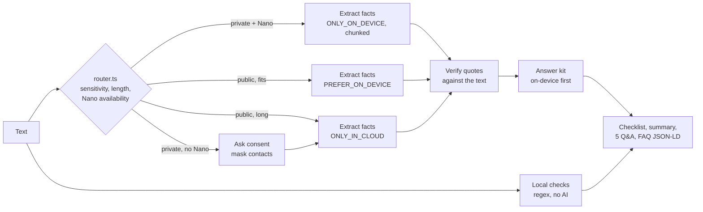

# CiteReady

**Is your page ready to be quoted by AI assistants?** Paste a web page or an unpublished draft. CiteReady pulls out the facts an assistant would quote (who, what, where, price, hours, dates, proof, contact), flags what is missing or vague, and writes an answer-first summary plus the five questions people are likely to ask, with draft answers.

The core is **hybrid inference with Firebase AI Logic**: private drafts are checked on the device with Gemini Nano, and long public pages or browsers without Nano use a cloud Gemini model. The UI shows which path ran for every step, and why.

- **Live app:** https://citeready.web.app
- **Chrome extension:** [`extension/`](extension/) (load unpacked; sends the current tab to the app)
- **Built for:** #BuildHybridAI 2026, Web (Chrome) category
- **License:** Apache-2.0

---

## Why this exists

When someone asks an AI assistant "how much is a check-up at X" or "is Y open on Sunday", the assistant answers from facts it can find written on a page. Pages that say "affordable prices", "conveniently located" or "contact us for pricing" give it nothing to quote. At Canlah AI we help small businesses get their pages cited by AI assistants, and the first job is always the same: find the missing and vague facts.

That job often happens **before** a page is public: launch pages, client copy under NDA, internal drafts. Those shouldn't be pasted into a cloud tool by default. An on-device model is the natural fit, but it isn't on every machine and has a small context window. So CiteReady treats on-device and cloud as one system with an explicit policy.

## What it does

1. **Local checks first (no AI, instant):** regex detectors for prices, opening hours, dates, phone, email, links, addresses and proof (years, ratings, licences), plus a list of vague phrases with a concrete fix for each.
2. **Extract facts (AI):** a structured-output prompt returns facts with the exact quote from the text. CiteReady **verifies every quote against the source** and drops facts that are not written there, which matters for a small on-device model. Vague facts ("every morning", "near the park") don't count as present.
3. **Write the answer kit (AI):** from the verified facts only, an answer-first summary and 5 likely questions with answers. Missing facts become fill-in templates like `[add opening hours]`, never guesses.
4. **Readiness checklist:** 9 explainable checks, each with its evidence (a quote or a pattern match) and a fix. No opaque score.
5. **FAQ JSON-LD:** schema.org `FAQPage` markup built from the answers that have no blanks left.

## How the hybrid inference works

Every model call goes through [`src/ai.ts`](src/ai.ts), which creates a Firebase AI Logic `GenerativeModel` with both on-device and cloud parameters and reads `response.inferenceSource` afterwards:

```ts
import { getAI, getGenerativeModel, GoogleAIBackend, InferenceMode, InferenceSource } from 'firebase/ai';

const ai = getAI(app, { backend: new GoogleAIBackend() });     // Gemini Developer API
const model = getGenerativeModel(ai, {
  mode: InferenceMode.ONLY_ON_DEVICE,                           // chosen per step by src/router.ts
  onDeviceParams: {
    createOptions: { expectedInputs: [{ type: 'text', languages: ['en'] }], initialPrompts: [/* system */] },
    promptOptions: { responseConstraint: FACTS_SCHEMA },        // structured output on Gemini Nano
  },
  inCloudParams: {
    model: policy.cloudModel,                                   // from Remote Config
    generationConfig: { responseMimeType: 'application/json', responseSchema: cloudSchema },
  },
});
const result = await model.generateContent(prompt);
const ranOnDevice = result.response.inferenceSource === InferenceSource.ON_DEVICE;
```

The SDK already knows how to "prefer on-device, otherwise cloud". What it cannot know is **whether the text is allowed to leave the device**. [`src/router.ts`](src/router.ts) adds that policy on top of the four `InferenceMode`s:

| Input | Gemini Nano | What CiteReady does | Mode used |
|---|---|---|---|
| Private draft, fits one on-device slice | ready | Everything on the device. 0 characters uploaded. | `ONLY_ON_DEVICE` |
| Private draft, longer than one slice | ready | Split into parts, each part read on the device, results merged. | `ONLY_ON_DEVICE` × N |
| Private draft | not available | **Stops.** "Nothing has left this device." The user can allow the cloud; emails and phone numbers are masked first. | `ONLY_IN_CLOUD` after consent |
| Public page, fits | ready / not available | On-device when possible, SDK falls back to the cloud otherwise. | `PREFER_ON_DEVICE` |
| Public page, too long for one slice | any | The cloud reads the long page in one pass; the short answer-kit step still prefers the device. | `ONLY_IN_CLOUD` then `PREFER_ON_DEVICE` |

The pipeline is split into two small steps on purpose: fact extraction reads the full text; the answer kit reads only the verified facts (a few hundred characters), so it can run on Gemini Nano even when the page itself was too long for it. That is why a single check can be **hybrid**: one step in the cloud, one on the device. The route card shows each step's requested mode, the actual `inferenceSource`, the time taken and the number of characters sent to the cloud.



### Firebase products used

| Product | How |
|---|---|
| **Firebase AI Logic** | Hybrid `GenerativeModel` (Chrome Prompt API / Gemini Nano on-device, Gemini Developer API in the cloud), structured output on both paths, `initializeDeviceModel()` for the one-time Nano download with a progress bar, `inferenceSource` for the route log. |
| **App Check** | reCAPTCHA Enterprise provider, **enforced** for Firebase AI Logic. Local development uses a debug token (never in production builds). |
| **Remote Config** | The routing policy: cloud model name, on-device slice size, max on-device parts for private drafts, contact masking default, prompt version. Changing the policy needs no redeploy. Template: [`remoteconfig.template.json`](remoteconfig.template.json). |
| **Hosting** | Serves the app at citeready.web.app. |

## Try it

1. Open https://citeready.web.app in Chrome on a desktop.
2. Click a sample (**Private launch draft**, **Public clinic page**, **Long public page**) or paste your own text.
3. Choose **Private draft** or **Public page** and click **Check readiness**.
4. The **Where the AI ran** card shows each step's mode and actual inference source.
5. Use **Routing options → Route** to force on-device or cloud when testing.

### To get the on-device path

Gemini Nano runs in desktop Chrome 139 or newer on machines that meet Chrome's built-in AI hardware and storage requirements.

1. Go to `chrome://flags/#prompt-api-for-gemini-nano-multimodal-input`, set it to **Enabled**, restart Chrome.
2. Open CiteReady, click the pill in the top-right corner, then **Download Gemini Nano (one time)** if offered. The first download can take several minutes.
3. When the pill says **Gemini Nano ready on this device**, run the **Private launch draft** sample: the route card should read "Ran entirely on this device" with 0 characters sent to the cloud.

Without Nano, public pages still work through the cloud, and private drafts show the consent step instead of uploading.

### Chrome extension

1. `chrome://extensions` → enable Developer mode → **Load unpacked** → select the [`extension/`](extension/) folder.
2. On any page, click the CiteReady icon → optionally tick "This page is private" → **Check this page**.
3. The extension reads the page text and opens CiteReady with it in the URL fragment (`#import=…`), which browsers never send to a server. All AI work happens in the web app, under App Check.

## Run it yourself

Requirements: Node 20+, a Firebase project on the free Spark plan.

1. Create a Firebase project and a Web app. In the Firebase console open **AI Logic → Get started → Gemini Developer API**.
2. App Check: create a reCAPTCHA Enterprise key for your domains (`gcloud recaptcha keys create --web --integration-type=SCORE --domains=localhost,<your-site>.web.app`), register it for your web app under **App Check**, then enforce App Check for Firebase AI Logic.
3. `cp .env.example .env.local` and fill in your web app config and the reCAPTCHA site key.
4. `npm install`
5. `npm run dev` and open the printed URL. On first load the browser console prints an App Check debug token; add it under **App Check → Apps → Manage debug tokens** (or put a registered token in `VITE_APPCHECK_DEBUG_TOKEN`).
6. Optional: `npx firebase-tools deploy --only remoteconfig` to publish the routing policy, `npm run build && npx firebase-tools deploy --only hosting` to host it (edit `.firebaserc` / `firebase.json` for your site name).

Tests: `npm test` (routing policy, local detectors, quote verification, checklist, schema conversion).

## Project layout

```
src/ai.ts          Firebase AI Logic hybrid model factory, device probe, Nano download
src/router.ts      Routing policy on top of InferenceMode (pure, unit-tested)
src/firebase.ts    App, App Check (reCAPTCHA Enterprise), Remote Config, getAI()
src/prompts.ts     Prompts and JSON schemas (on-device responseConstraint + cloud responseSchema)
src/rules.ts       Local detectors, vague-phrase rules, contact masking, chunking, quote matching
src/checklist.ts   Fact verification, merge of chunk results, checklist, FAQ JSON-LD
src/main.ts        UI
extension/         Chrome extension (Manifest V3)
tests/             Vitest unit tests
```

## What leaves the device

- **Private draft + Gemini Nano available:** nothing. The route card shows 0 characters sent.
- **Private draft without Nano:** nothing until you click "Send a masked copy to the cloud". Emails and phone numbers are replaced with `[email]` / `[phone]` first (configurable).
- **Public page:** the prompt goes to the cloud model only when the SDK falls back or the page is too long for the device.
- CiteReady has no database and stores no text. Firebase Remote Config, Installations and App Check requests carry no page text.

## Limitations

- Gemini Nano is only available in desktop Chrome on supported hardware with enough free disk space; everyone else gets the cloud path (public pages) or the consent step (private drafts).
- On-device requests are capped at 9,216 tokens, so CiteReady slices text at 12,000 characters (tunable in Remote Config).
- Gemini Nano is a small model. Quote verification removes invented facts, but it can still miss facts or mislabel them.
- The checks describe what an assistant can quote from the text; they don't predict whether any particular assistant will cite the page.

## Built during the submission period

Everything in this repository was written from scratch for #BuildHybridAI 2026 (from November 20, 2026): the routing policy, the two-step hybrid pipeline, quote verification, local detectors, the UI, the Chrome extension, the Firebase setup (AI Logic, App Check with reCAPTCHA Enterprise, Remote Config, Hosting) and the tests. No pre-existing code was reused. It was built with the help of an AI coding assistant (Claude Code). Third-party code: the Firebase JS SDK, Vite, TypeScript and Vitest, under their own licenses.

## License

Apache-2.0. See [LICENSE](LICENSE). © 2026 Canlah AI Pte. Ltd.
